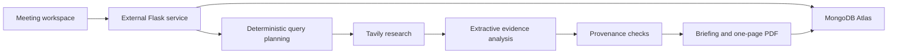

# MeetBrief AI

Know the Important Things Before You Enter the Room.

Source-backed pre-meeting intelligence for Global AI Hackathon 2026, Problem Statement 05. No fabricated meetings, research findings or simulated progress.

## Architecture

React 19 + TypeScript + TanStack Start + Tailwind v4 are hosted here. The Flask service in `backend/` is deployed separately on Render with MongoDB Atlas. Flask cannot run in this frontend host. All live searches use Tavily. Analysis is extractive — every development is a verbatim sentence from a cited source — with no AI model dependency.



## Setup and deployment

Frontend: `bun install`, then `bun dev`. Set the public `VITE_API_BASE_URL` in frontend environment settings. Alternatively enter the Flask service address in Settings for this browser session. Private keys must never use the VITE prefix.

External service: install `backend/requirements.txt` in a Python virtual environment. On Render, choose `backend` as the root directory, `pip install -r requirements.txt` as the install command, and `gunicorn --workers 1 --threads 4 --timeout 180 app:app` as the start command. Set environment variables securely in Render, not in committed files.

Configure Atlas network access for Render and provide its private URI. Include the actual published frontend and preview origins in CORS_ORIGINS. Browser requests need an HTTPS external service in production. The uploaded configuration was not copied: it is not a recognized dotenv configuration.

## Environment

See `.env.example` and `backend/.env.example` for names without private values.

| Variable | Where | Purpose |
|---|---|---|
| VITE_API_BASE_URL | Frontend | Public external service URL |
| TAVILY_API_KEY | Flask | Tavily search credential |
| MONGODB_URI | Flask | Private Atlas connection URI |
| MONGODB_DB | Flask | Database name, default meetbrief |
| CORS_ORIGINS | Flask | Comma-separated allowed frontend origins |
| MAX_QUERIES_PER_RUN | Flask | Up to six queries |
| MAX_RESULTS_PER_QUERY | Flask | Up to ten results |
| MAX_SOURCES_USED | Flask | Up to thirty trimmed sources |
| FLASK_ENV | Flask | Production configuration label |

## Official documentation consulted

- https://docs.tavily.com/documentation/api-reference/endpoint/search

Tavily uses POST /search, Bearer auth, news topic, advanced search, meeting-relative start/end dates, published dates and generated answers disabled. Query planning is deterministic from meeting fields, and analysis is extractive: each development is a verbatim source sentence validated by tested provenance rules. Health probes execute an actual Tavily search and a MongoDB ping; probes may incur usage costs.

## API

JSON envelope: `{success, data, error: {code, message}}`. PDF returns binary.

- GET /api/health — actual probes or not-configured states
- GET/POST /api/meetings — latest 100 meetings / validated meeting creation
- GET /api/meetings/<meeting_id>
- POST /api/research — meeting_id, immediate run_id, in-process background task
- GET /api/research/status/<run_id> — persisted stages and actual counters
- GET /api/research/results/<run_id>
- GET /api/briefings/<briefing_id>
- GET /api/briefings/<briefing_id>/pdf

Briefing generation is part of the research pipeline, not a separate generation endpoint. Invalid inputs return 422, missing records 404, rate limits 429, service/storage failures 503. Upstream errors become explicit failed run states, not fake completed briefings.

## Evidence and dates

Window is inclusive `[meeting date − 30 days, min(meeting date, today)]` in the named timezone. November 20, 2026 starts October 21. Past meetings are allowed with warnings; entirely future windows are rejected. Unknown dates never count as recent. Tracking parameters/fragments are removed. Developments require retrieved source IDs and a matching verbatim excerpt of at most 40 words. Failed provenance validation stops publishing. A matching excerpt alone does not prove a paraphrase; model classifications of Supported are conservatively downgraded to Partially Supported.

## Testing

```
bunx vitest run src/test/meeting.test.ts src/test/app-routing.test.tsx
PYTHONPATH=backend python -m pytest backend/tests -q
```

Executed: 7 frontend tests and 14 Python tests passed. Browser checks confirmed dashboard rendering on desktop/mobile, no mobile horizontal overflow, navigation, and a clear error when submitting without a configured service. No browser runtime errors observed. Live Tavily, MongoDB and the full research-to-PDF flow are **NOT YET TESTED**: external deployment URL and credentials are absent. Unit tests do not prove live integration success.

## Known limitations / remaining phases

- Initial vertical slice, not acceptance-complete production software.
- External service is single-workspace without application authentication. CORS is not authorization: restrict access via a secure reverse proxy before storing private meetings or enabling paid calls publicly.
- In-process research threads are interrupted by service restarts; production needs durable jobs and stale-run recovery.
- Independent corroboration, source credibility tiers, conflict comparison and explicit identity-disambiguation handling need further work. Current checks validate provenance, not truth.
- Searches currently execute sequentially. Opportunity and risk suggestions are not generated without an analysis model; those sections show an explicit empty state.
- Token/latency metrics, detailed confidence charts and aggregate source/activity dashboard stats are not implemented; unavailable stats show a dash.
- Unknown-date evidence is retained in sources but excluded from recent developments.
- PDF fits one page by truncating lower-priority details with a full-details note; full real-data scenarios and citation coverage remain unverified.
- Process-local rate limiting requires the single-worker deployment described above.

## Demo after deployment

Test connections in Settings. Create a meeting, inspect its date window, follow actual research counters, inspect briefing evidence and uncertainty labels, download PDF and revisit history. Test bad provider credentials to demonstrate failure rather than false success.

## Screenshot studio

The independent `/screenshot` tool sends a PNG/JPEG/WebP screenshot to AI Gateway through a TanStack server function and returns standalone HTML/CSS. It uses the workspace-allowed `openai/gpt-6.1-terra` Responses model because the default text endpoint is not permitted by this workspace's retention policy. Generated code previews in a sandboxed iframe with scripts, external requests, forms and parent access blocked. Users can copy or download HTML; generated layouts are approximations, not recovered original code or photos. Input/output is not stored in Cloud. AI usage requires workspace credits. This feature never changes Tavily-only research.

The external Flask starter reads process environment variables; placing credentials in a `.env` file alone does not load them. On Windows PowerShell, set `$env:TAVILY_API_KEY`, `$env:MONGODB_URI` and `$env:CORS_ORIGINS` before `python app.py`. On Render, use its environment settings. A local workspace can connect to `http://localhost:5000`; the hosted workspace needs an HTTPS deployment.
